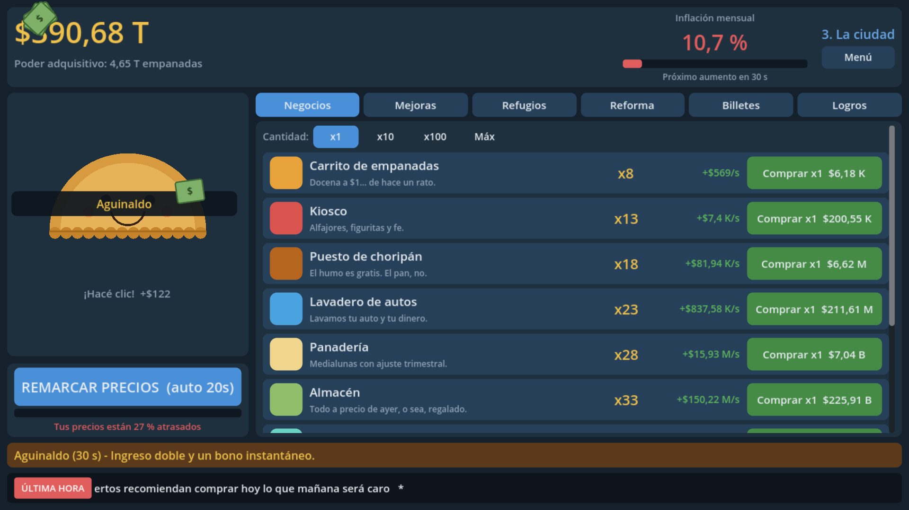
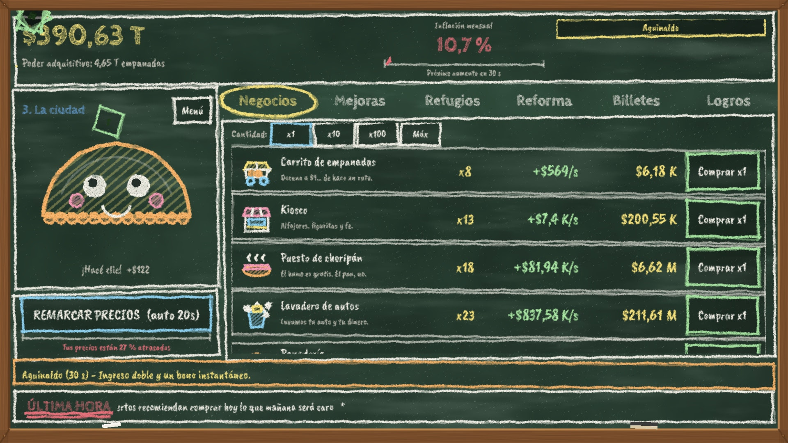
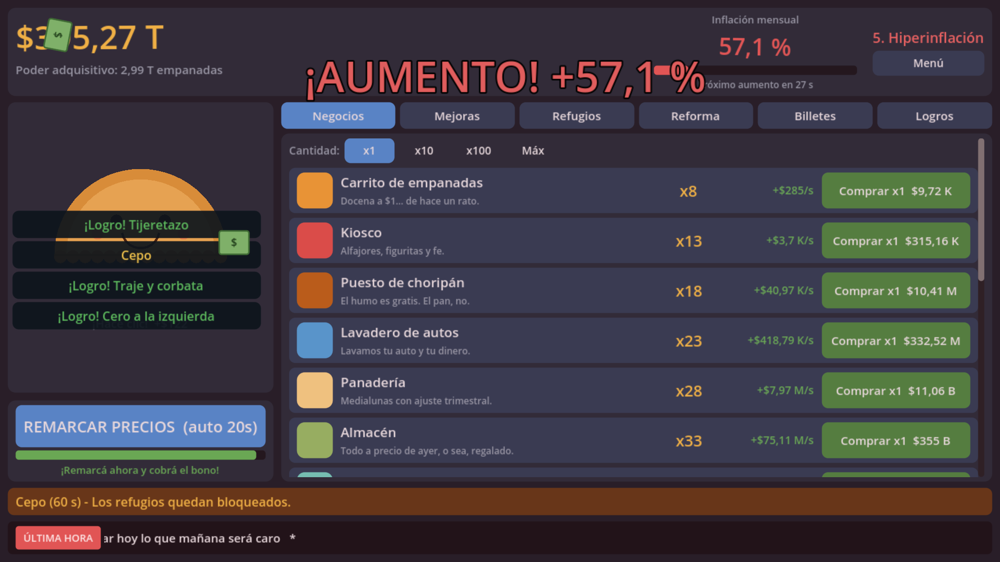
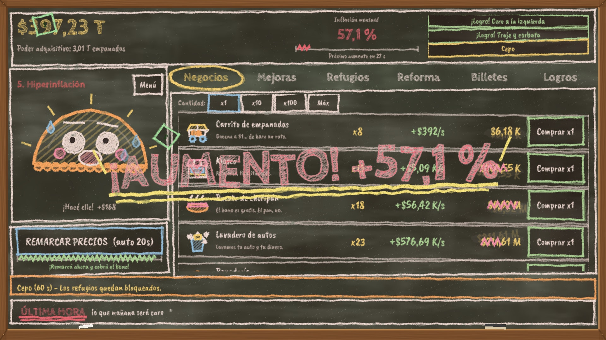
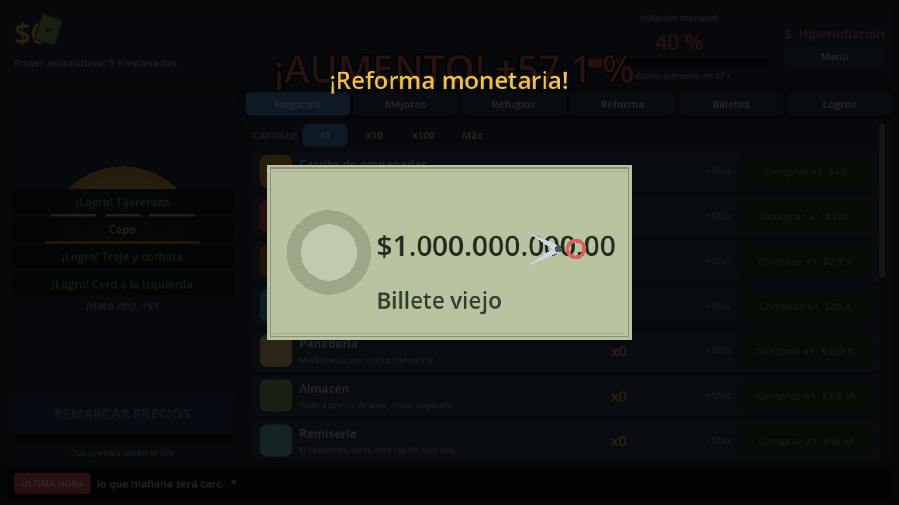
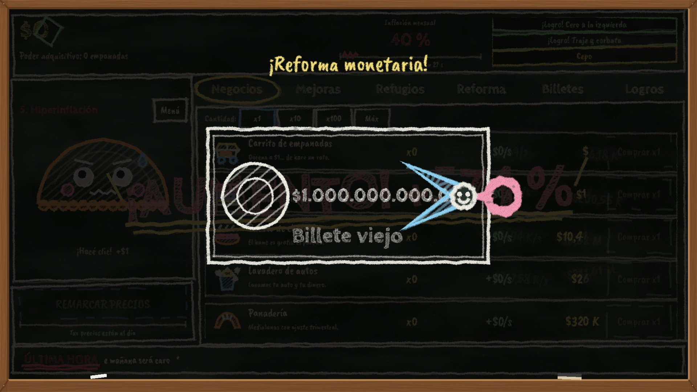
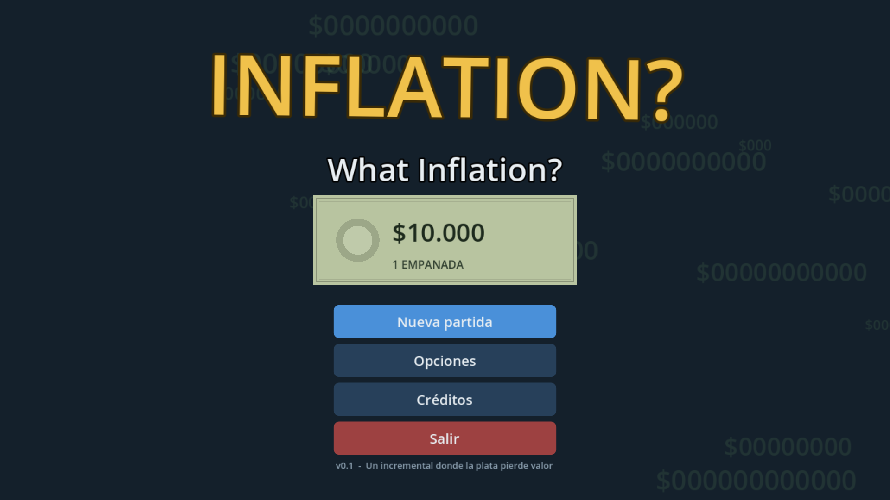
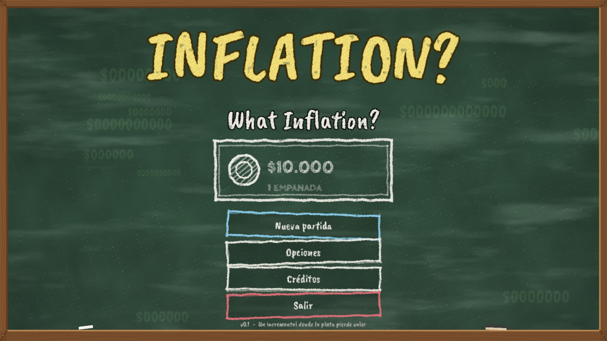
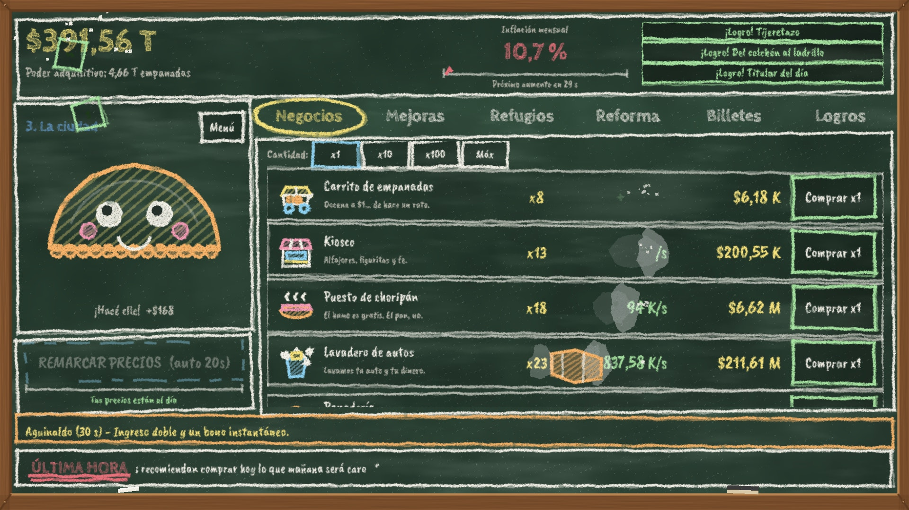

# Rediseño: pizarra de kiosco caricaturesca

Cambio de dirección de arte: todo el juego está dibujado "con tiza sobre un pizarrón", en tono caricatura. Solo cambió la presentación: la lógica, los datos y los tests siguen iguales (1229 chequeos en verde).

## Antes y después

| Pantalla | Antes (UI plana azul/gris) | Después (pizarra de kiosco) |
| --- | --- | --- |
| Negocios, Era 3 (1920x1080) |  |  |
| Hiperinflación |  |  |
| Reforma (tijera) |  |  |
| Menú principal |  |  |
| Remarcando (nuevo) | no existía |  |

Capturas "antes": `docs/screenshots/antes/` (PNG). Capturas "después", en las tres resoluciones pedidas: `docs/screenshots/<ancho>x<alto>_*.jpg` (1920x1080, 1280x800 y 2560x1440; 13 por resolución). Se regeneran con:

```
TOUR_RES=1920x1080 SHOT_DIR=docs/screenshots godot --rendering-driver opengl3 res://tests/ScreenshotTour.tscn
```

## Qué se hizo, punto por punto

**1. Base visual**
- Fondo: pizarrón verde `#2F4A3A` con shader (`assets/shaders/board.gdshader`): ruido, polvo de tiza y borrones viejos semitransparentes. Con inflación alta aparecen más borrones.
- Marco de madera dibujado por código alrededor de la pantalla (veta, bisel, clavos), con tiza y borrador en la repisa (`wood_frame.gd`).
- Paleta de tizas exacta: blanco `#F2EFE6`, amarillo `#F7E27A`, rosa `#F59AB5`, celeste `#8FD3F4`, verde `#A8E6A1`, naranja `#F7B267`. Excepción: una tiza roja suave (`#E8707A`) solo para alertas ("ÚLTIMA HORA", tasa de inflación), como se pidió para la cinta.
- Efecto tiza para todos los trazos y textos: una sola pasada de pantalla completa (`assets/shaders/chalk_post.gdshader`) que ensucia los bordes, vuelve irregular la opacidad y deja huecos donde "la tiza no marcó". El marco de madera queda fuera de la pasada.
- Tipografías (OFL, de github.com/google/fonts, con sus licencias en `assets/fonts/`): **Cabin Sketch** (títulos, pestañas, números grandes) y **Caveat Brush** (textos y botones).

**2. Componentes**
- Paneles y botones: `ChalkStyle`, un `StyleBox` propio que dibuja polilíneas con jitter estable (siempre igual para el mismo componente), doble trazo y rotación de entre -1,8° y 1,8°. Sin rectángulos perfectos ni esquinas redondeadas de interfaz.
- Presionado: trazo más grueso con relleno hachurado. Deshabilitado: trazo tenue y salteado, medio borrado.
- Pestañas: solo la palabra; la activa lleva un círculo de tiza (hover: subrayado).
- Barras: riel de tiza con relleno garabateado en zigzag.

**3. REMARCAR**
- Cada precio es un `ChalkPrice`: texto escrito a mano en la pizarra.
- Al remarcar a mano entra un trapo caricaturesco (`rag_wipe.gd`) que barre fila por fila: deja un manchón blanco, levanta polvo de tiza (partículas) y el precio nuevo se escribe letra a letra.
- Cada aumento mensual tacha los costos con un tachón rosa y los reescribe.
- Con más inflación: quedan manchones de los precios viejos debajo (hasta 6), los números se escriben más apretados y torcidos. En la hiperinflación (tasa mayor a 60 %): números chiquitos pegados al borde, con una flecha, y la pizarra casi toda manchada.
- El remarcado automático (mejoras) actualiza los precios sin trapo, para no saturar.

**4. Caricatura**
- 16 íconos de negocios dibujados por código con contorno grueso y relleno de tiza rayada (carrito, kiosco, choripán, balde con esponja, medialuna, almacén, taxi, tomate y zanahoria, fábrica, locales, banco, gráfico en alza, moneda y pico, imprenta, cero gigante, maletín con palmera): `chalk_icons.gd`.
- Si existe `assets/icons/<id>.png` se usa ese dibujo y el de código queda de respaldo (instrucciones en `assets/icons/README.md`).
- La empanada es el personaje: cara expresiva, los ojos siguen el mouse, parpadea; squash & stretch al clic; transpira con inflación alta (>15 %) y entra en pánico en la hiperinflación (>50 %: ojos enormes, boca abierta, temblor, rayitas de susto).
- Animaciones rebotonas: el número de plata salta, los íconos hacen un salto al comprar, los carteles se tambalean, las notitas aparecen con rebote, y "¡AUMENTO!" es un garabato gigante que se dibuja rápido (con doble subrayado y flechas) y después se borra con un manchón.

**5. Correcciones**
- Los logros y avisos van en una pila de notitas de tiza arriba a la derecha, dentro del HUD (máximo 3); ya no tapan la empanada ni el panel central. Era y botón de Menú pasaron a la columna izquierda para hacer lugar.
- "¡AUMENTO!" se posiciona debajo del HUD y nunca lo pisa.

**6. Billetes y reforma**: billetes dibujados en tiza (los ceros cortados quedan fantasma tras una línea de corte); la tijera es un dibujo caricaturesco con cara que corta los ceros, y los ceros caen como pedacitos de tiza.

**7. Cinta de noticias**: franja inferior del pizarrón con el texto en tiza; "ÚLTIMA HORA" en tiza roja subrayada dos veces.

## Rendimiento

- El efecto tiza es una sola pasada de pantalla completa con unas pocas muestras de ruido; los trazos de paneles se calculan una vez por tamaño (cache) y no por cuadro.
- En la hiperinflación el efecto se atenúa hasta un 30 % (`ChalkPost.set_strength`) y los precios dibujan menos detalle.
- No se midió en hardware real: en esta máquina la prueba corre fluida, pero conviene probar en una PC modesta. Si hiciera falta, el punto de ajuste es `strength` del shader.

## Decisiones y pendientes
- Las tipografías manuscritas son más chicas: el texto se escala x1,22 (`UIKit.FS`).
- Las capturas nuevas son JPG (calidad 0,9): el ruido de la tiza hacía pesar los PNG 8 veces más.
- Pendiente: probar el efecto en Web (el shader usa la textura de pantalla, soportada por el renderer de compatibilidad) y revisar los íconos con un ilustrador; son un respaldo de código.
